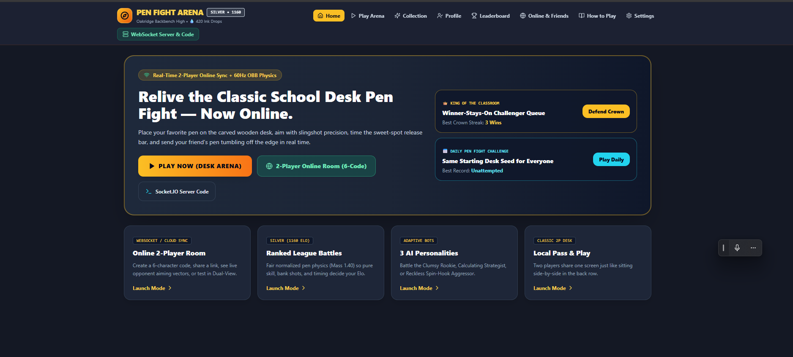
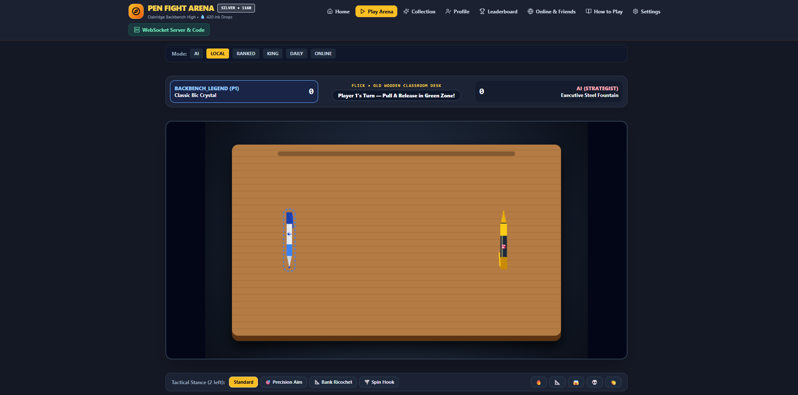

# Pen-Fight-Arena

## Online multiplayer setup

Online rooms use Firebase Authentication and Cloud Firestore so room codes work between separate devices. Configure a Firebase project before creating or joining a room:

1. Create a Firebase project and register a web app.
2. Enable **Anonymous** sign-in under Authentication providers.
3. Create a Cloud Firestore database.
4. Copy `.env.example` to `.env.local` and replace the sample values in `VITE_FIREBASE_CONFIG` with the web app's Firebase configuration JSON.
5. Add Firestore rules that allow authenticated players to access room documents:

```text
rules_version = '2';
service cloud.firestore {
  match /databases/{database}/documents {
    match /artifacts/{appId}/public/data/pen_fight_rooms/{roomCode} {
      allow read, write: if request.auth != null;
    }
  }
}
```

The rules above are suitable for testing. For production, validate room membership and allowed updates in your rules or through a trusted server. Set `VITE_FIREBASE_CONFIG` in your deployment environment when building the hosted app. Share the hosted app's room code or invite link; a `localhost` link only works on the same device.

## Screenshots

### Home



### Play Arena


